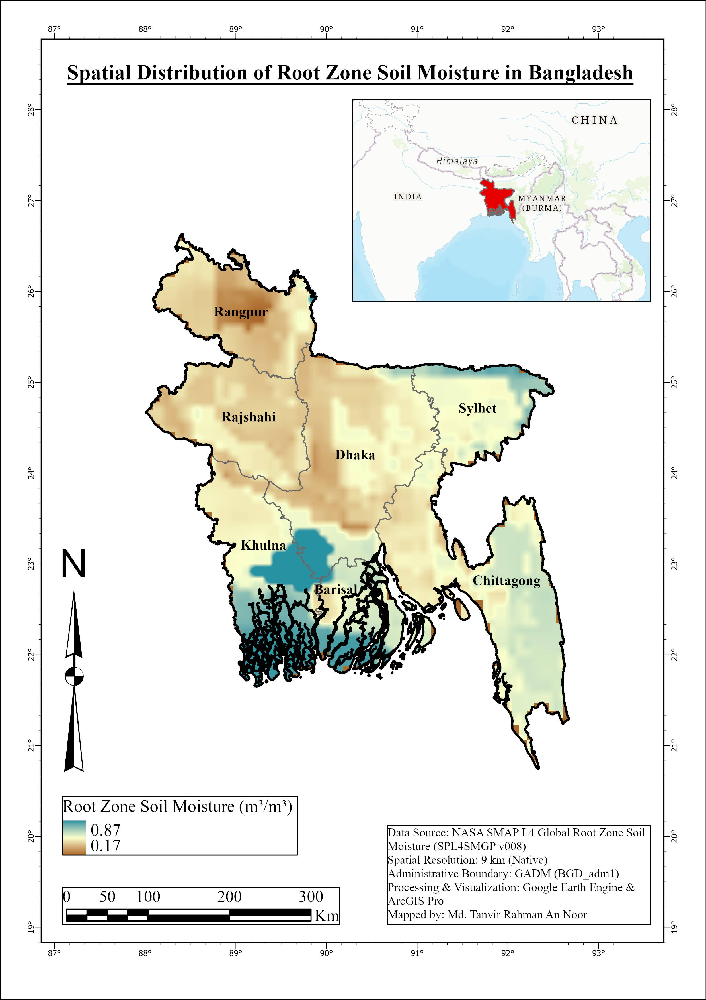
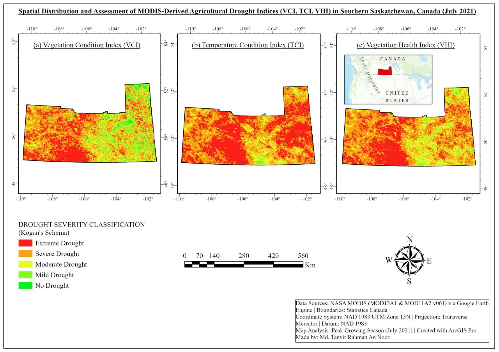

# Soil Moisture (NASA SMAP & Landsat SMI) and Agricultural Drought (MODIS) Analysis

* **Tools Used:** Google Earth Engine (JavaScript API), ArcGIS Pro
* **Datasets:** NASA SMAP L4 Soil Moisture, USGS Landsat LST & NDVI (30m), and NASA MODIS Imagery
* **Methodology:**
  1. **Root Zone Soil Moisture:** Analyzed 30-day mean root-zone soil moisture across Bangladesh using NASA SMAP L4 data.
  2. **30m Soil Moisture Index (SMI):** Automated a GEE workflow integrating Landsat LST and NDVI to map high-resolution soil moisture across Bangladesh.
  3. **Drought Indexing:** Computed Vegetation Condition Index (VCI), Temperature Condition Index (TCI), and Vegetation Health Index (VHI) from MODIS data.

### 1. Root Zone Soil Moisture Map (NASA SMAP L4)

### 2. Landsat 30m Soil Moisture Index (SMI) Map

### 3. Multi-Panel MODIS Drought Assessment (VCI, TCI, VHI)

